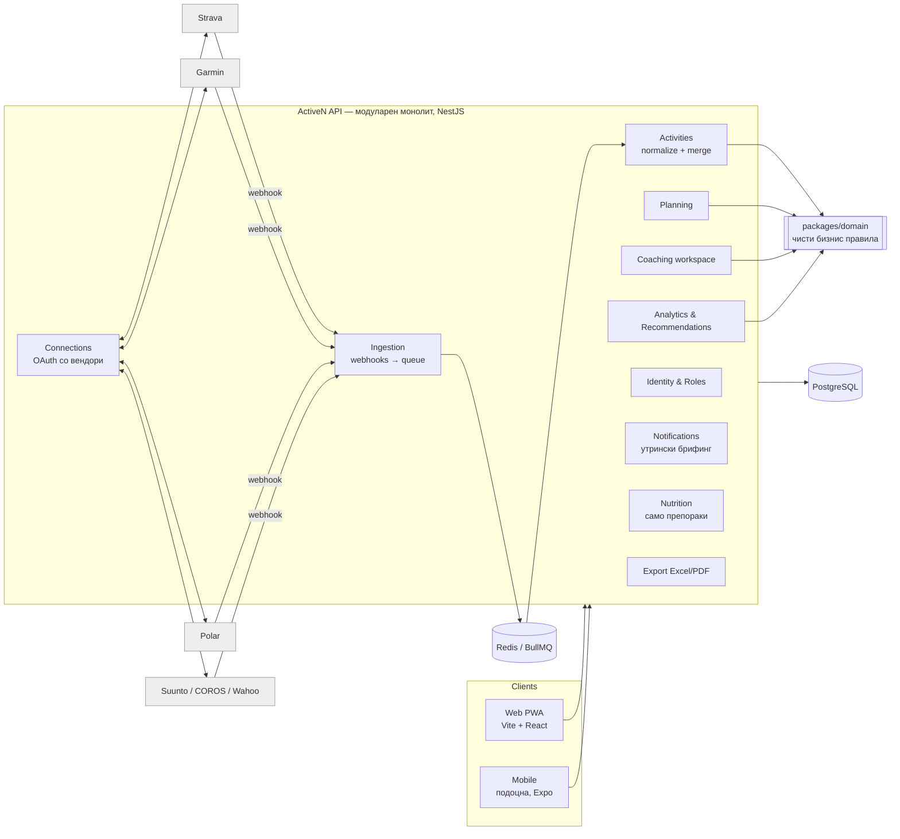
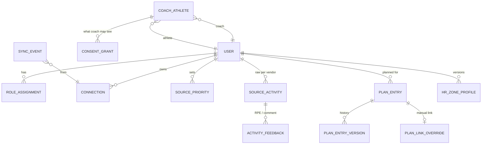

# ActiveN — Архитектура

> Статус: v0.4 (инкремент 3). Документот се ажурира со секој инкремент.
> Технички термини, код и коментари во кодот се на англиски; документацијата е на македонски.

## 1. Цел

ActiveN е платформа за планирање тренинзи, следење и анализа на перформанси, со два режима:

1. **Самостоен спортист** — поврзува еден или повеќе извори (Strava, Garmin, Polar, Suunto, COROS…),
   добива анализи, препораки и утрински брифинг.
2. **Workplace тренер ↔ спортист** — тренерот креира план, спортистот го извршува и дава повратна
   информација (RPE, тешко/лесно, коментар), двајцата гледаат анализи и препораки.

ActiveN е **сосема нова платформа, осмислена од почеток**. Функционалната спецификација
(`Strava_Training_App_Functional_Specification_v1`) и Excel извештајот (`Strava_Activities_VP_v26.xlsx`)
служат само како **контекст** — покажуваат што спортистот денес следи и кои пресметки му се важни.
Не ги копираме ниту изгледот ниту ограничувањата на Excel-от; грешките што ги најдовме во него се
документирани во `reference-excel-findings.md` за да не ги повториме.

**Терминологија и принципи:** Garmin во почетната фаза (ADR-0007, [garmin-glossary.md](garmin-glossary.md)).

**Јазици:** мултијазична платформа — mk и en од старт, i18n пакет и правила во ADR-0008.

**Извори на податоци:** примарно производителите на уреди (Garmin, Suunto, Polar, COROS…). Strava е
последна по приоритет и служи само за пополнување празнини (`DEFAULT_SOURCE_PRIORITY`).

## 2. Архитектонски принципи

| Принцип                      | Што значи во пракса                                                                                                                       |
| ---------------------------- | ----------------------------------------------------------------------------------------------------------------------------------------- |
| **Модуларен монолит**        | Еден deploy, јасни граници меѓу модулите. Делење на сервиси само кога ќе има реална потреба (оптоварување на sync worker-и).              |
| **Чист domain слој**         | Бизнис-правилата (`packages/domain`) се чисти функции без framework, база или мрежа → 100% unit тестабилни.                               |
| **Вендор-агностичен модел**  | Секој вендор е адаптер што мапира во заеднички `Activity` модел. Ниту еден модул надвор од адаптерите не знае за Strava/Garmin специфики. |
| **Policy пред merge**        | Правилата од договорите на вендорите (кој смее да види, дали смее AI) се применуваат пред спојување на податоците.                        |
| **Асинхрона интеграција**    | Webhook-ови само ставаат настан во ред; worker-и ги обработуваат идемпотентно со retry.                                                   |
| **Privacy by design (GDPR)** | Здравствените податоци се посебна категорија: експлицитна согласност, енкрипција, право на бришење/извоз, хостирање во ЕУ.                |

## 3. Компоненти



### 3.1 Модули

| Модул                | Одговорност                                                                                                           |
| -------------------- | --------------------------------------------------------------------------------------------------------------------- |
| **Identity & Roles** | Најава (Google, Apple, email/passkey), профил, улоги `athlete`, `coach`, `admin`. Еден корисник може да биде и двете. |
| **Connections**      | OAuth со секој вендор, енкриптирани токени, приоритет на извори по корисник, деавторизација → бришење податоци.       |
| **Ingestion**        | Прием на webhook-ови, backfill (од 01.01.2023), рачно освежување, статус на sync (SYNC-01..07).                       |
| **Activities**       | Нормализација, де-дупликација и спојување по приоритет (`mergeActivities`), soft-delete.                              |
| **Planning**         | План-записи, одмор, увоз Excel/CSV, историја на промени, поврзување план↔активност (`matchPlanToActivities`).         |
| **Coaching**         | Врски тренер↔спортист со согласност, групи, коментари, RPE/чувство, препорака на тренерот.                            |
| **Analytics**        | Неделни/месечни/годишни збирови, HR зони, тренд, план vs реализација, предикции.                                      |
| **Notifications**    | Утрински брифинг (план за денес + rest HR, HRV, sleep score), push/email.                                             |
| **Nutrition**        | Препораки за исхрана и суплементи — јасно означени како информативни, одговорност на корисникот.                      |
| **Export**           | Excel извештај што го репродуцира референтниот workbook; PDF подоцна.                                                 |

## 4. Модел на податоци (концептуално)



Клучни одлуки:

- **Сурови податоци по извор** (`SOURCE_ACTIVITY`) се чуваат одделно за секој вендор. Спојувањето е
  пресметка, не запис — така policy-то по публика (сопственик/тренер/AI) секогаш се применува коректно.
- **План и активност се независни**; врската се пресметува, рачните одлуки се чуваат во `PLAN_LINK_OVERRIDE`.
- **HR профили се непроменливи верзии** со `effectiveFrom` (HR-04, HR-05).
- **`SYNC_EVENT`** има уникатен клуч `(vendor, object_id, aspect, event_time)` → идемпотентност (SYNC-05).

## 5. Интеграција со вендори

| Вендор                     | Пристап (ноември 2026)                                   | Може тренер да види?          | AI?           |
| -------------------------- | -------------------------------------------------------- | ----------------------------- | ------------- |
| Strava                     | OAuth2, webhooks, отворен developer пристап со лимити    | **Не** — само сопственикот    | **Не**        |
| Garmin                     | Connect Developer Program; **нови апликации паузирани**  | Да (да се потврди во договор) | Да се потврди |
| Polar                      | AccessLink v3, OAuth2, отворен за регистрирани корисници | Да (да се потврди)            | Да се потврди |
| Suunto                     | Партнерска програма (потребно одобрување), FIT фајлови   | Да (да се потврди)            | Да се потврди |
| COROS, Wahoo               | Партнерски програми                                      | Да се потврди                 | Да се потврди |
| Рачно / FIT-GPX-TCX upload | Нашиот систем                                            | Да                            | Да            |

Последици за дизајнот:

1. **Тренерскиот workplace не смее да се потпира на Strava.** Тренерот ги гледа само податоците од
   извори што го дозволуваат тоа (Polar, Garmin…, или директен upload на FIT фајл). Ова е вградено во
   `mergeActivities({ audience: "coach" })` — Strava вредностите никогаш не стигнуваат до тренерот.
2. **AI препораки (LLM) не смеат да користат Strava податоци.** Препораките за Strava-корисници се
   правило-базирани (детерминистички пресметки), прикажани само на сопственикот.
3. **Деавторизација** кај вендор → ги бришеме неговите податоци (барање на Strava и GDPR).
4. **Креирање workout-и кај вендор** (Garmin Training API, итн.) е опционален адаптер по вендор.

### 5.1 Канонски модел на податоци

Сите полиња, единици и мапирања по вендор се во [data-catalog.md](data-catalog.md) и
[data-catalog-fields.md](data-catalog-fields.md) (ADR-0006).

## 6. Безбедност и приватност

- Најава и сесии (ADR-0010): Google/Apple ID токени или email линк; краткотрајни access токени (Ed25519),
  ротирачки refresh токени (HttpOnly колаче на web), детекција на повторна употреба, проверка на сесија на
  секое барање, rate limiting на најавата.
- OAuth токени на вендори: енкрипција на ниво на поле (envelope encryption, клуч во KMS/Secret Manager).
- Сите здравствени податоци: експлицитна согласност при поврзување; согласност за споделување со тренер
  е посебна, грануларна и повлечлива (`CONSENT_GRANT`).
- Row-level авторизација: секој запит е ограничен на `athlete_id` или на активна врска тренер↔спортист.
- Право на извоз и бришење на сите податоци (GDPR чл. 15, 17, 20).
- Аудит лог за пристап на тренер до податоци на спортист.
- Што гледа тренерот се одлучува на едно место: `Viewer` (`packages/contracts/src/viewer.ts`) ги
  претвора согласностите во дозволи (активности, коментари, локација). API-то и демото го користат истиот
  `Viewer`. Коментарот од check-in-от стигнува до тренерот само со согласноста „коментари“.

## 7. Квалитет и испорака

- **Тестирање**: unit тестови на domain (праг на покриеност 90% линии), интеграциски тестови на API со
  вистински PostgreSQL (привремена база по извршување, ADR-0009), contract тестови за секој вендор адаптер со снимени одговори,
  E2E (Playwright) за главните текови.
- **CI**: `pnpm verify` (format → lint → typecheck → test) на секој commit; deploy само ако е зелено.
- **Опсервабилност**: структурирани логови, OpenTelemetry трагови, метрики за sync лаг и неуспешни настани.
- **Hosting**: ЕУ регион (GDPR); контејнери; управуван PostgreSQL и Redis.

## 8. Структура на репото

```
activen/
├── apps/
│   ├── api/           # NestJS REST API: auth, профил, календар/план/активности/check-in, напредок, тренер, OpenAPI
│   └── web/           # Vite + React PWA: спортист и тренер; HTTP и демо режим (ADR-0011)
├── packages/
│   ├── domain/        # чисти бизнис правила (само кодови, без текст) + unit тестови
│   ├── contracts/     # заеднички договор API ↔ клиенти: DTO, view builders, демо податоци; zod шеми (/requests)
│   ├── i18n/          # јазици, ICU пораки mk/en, форматирање по јазик и единици
│   └── db/            # Drizzle шема, миграции, repository слој + интеграциски тестови (ADR-0009)
└── docs/
    ├── architecture.md
    ├── extending.md   # како се додава нова функционалност (рецепти)
    ├── testing.md     # слоеви на тестови, сценарија, прагови
    ├── deployment.md  # домен activen.app, DNS, конфигурација
    ├── roadmap.md
    ├── open-questions.md
    └── adr/           # Architecture Decision Records
```
