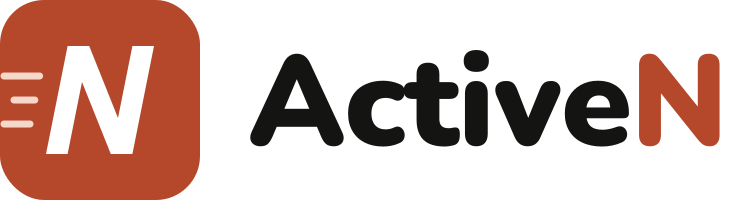

# ActiveN — лого и логотип

Финално лого, одбрано на 23.11.2026: варијантата **A3a-s, „N во движење“**. Ја избравме од
варијантите на платното за дизајн „ActiveN — лого „N во движење““.

## Делови

| Дел               | Што е                                                                       | Датотека                                                    |
| ----------------- | --------------------------------------------------------------------------- | ----------------------------------------------------------- |
| **Знак**          | Буквата N наведната напред, со три линии на брзина од левиот раб.           | `activen-mark.svg`, `activen-mark-white.svg`                |
| **Икона**         | Знакот на теракота квадрат со заоблени агли (икона на апликација, фавикон). | `activen-icon.svg`, PNG: 512, 192, 180 (Apple), 32          |
| **Логотип**       | Иконата и зборот „ActiveN“, со последното N во бојата на брендот.           | `activen-logotype.svg`, `activen-logotype-dark.svg` (+ PNG) |
| **Зборовен знак** | Само „ActiveN“, без икона (тесни места, потпис во е-пошта).                 | `activen-wordmark.svg`                                      |

Буквите во SVG датотеките се претворени во патеки, па логотипот изгледа исто и без инсталиран фонт.

## Конструкција (мрежа 100 × 100)

- **Рамка**: квадрат 100 × 100 со радиус на аглите 22.
- **N**: три коси потези, широки 12 единици со наклон 1 : 5, споени во една контура.
  - Скалиран е на 90 % и центриран во рамката. Опфаќа x 23–77 и y 23–77.
  - Контура: `M23 77 L33.8 77 L41 41 L55.4 77 L66.2 77 L77 23 L66.2 23 L59 59 L44.6 23 L33.8 23 Z`.
- **Линии на брзина**: три хоризонтални линии, дебели 3,5, со заоблени краеви, на y 38, 50 и 62.
  Оската на средната линија е оската на буквата.
  - Горната и долната почнуваат од работ на рамката (x 2). Средната е пократка и почнува на x 7.
  - Десните краеви го следат наклонот на N, со ист простор од 11 единици до буквата:
    x 19,8 / 17,4 / 15.
- **Логотип**: иконата е висока 100. Зборот почнува 24 единици десно од иконата.
  - Фонт: Nunito Black (900), 64 единици.
  - Висината на големите букви (45) е центрирана на средината на иконата.

## Бои

| Име             | Hex       | Употреба                                                      |
| --------------- | --------- | ------------------------------------------------------------- |
| Теракота        | `#B5482B` | Рамка на иконата, знакот на светла позадина, „N“ во логотипот |
| Праска          | `#F6D7C9` | Линиите на брзина врз теракота                                |
| Бела            | `#FFFFFF` | N врз теракота, знакот врз фотографии и темни површини        |
| Мастило         | `#141413` | „Active“ на светла позадина                                   |
| Крем            | `#FAF7F2` | „Active“ на темна позадина                                    |
| Теракота светла | `#F08A62` | „N“ во логотипот на темна позадина                            |

Теракотата е истата `--primary` боја како во апликацијата (`apps/web/src/styles/app.css`).

## Правила

- **Празен простор**: околу логотипот остави најмалку 25 % од висината на иконата (25 единици)
  без текст и слики.
- **Најмала големина**:
  - иконата 16 px (фавикон; линиите стануваат пиксел-тенки, но N останува читливо);
  - логотипот 96 px ширина на екран, 24 mm во печат.
- **Не**:
  - не ги менувај боите надвор од табелата;
  - не ја растегнувај и не ја ротирај иконата;
  - не додавај сенки, преливи или контури;
  - не ги менувај бројот, должината и наклонот на линиите;
  - не го пишувај логотипот со друг фонт.
- На фотографии користи `activen-mark-white.svg` или иконата со рамката. Не стави само теракота N
  врз шарена позадина.

## Каде се користи

- Веб-апликација:
  - `apps/web/public/icon.svg` (фавикон и лого во навигацијата);
  - `favicon-32.png`;
  - `apple-touch-icon.png` (икона на почетен екран на iPhone).
- Логото во навигацијата е иконата и зборот „ActiveN“, со последното N во `--primary`.
- Е-поштата засега е само текст. Кога ќе стане HTML, во заглавието оди `activen-logotype.png`
  (на светла позадина).

## Лиценца на фонтот

Nunito е под SIL Open Font License 1.1, која дозволува вградување во лого и графика. Буквите во
логотипот се претворени во патеки од `@fontsource-variable/nunito`, со оската `wght` поставена на 900.
